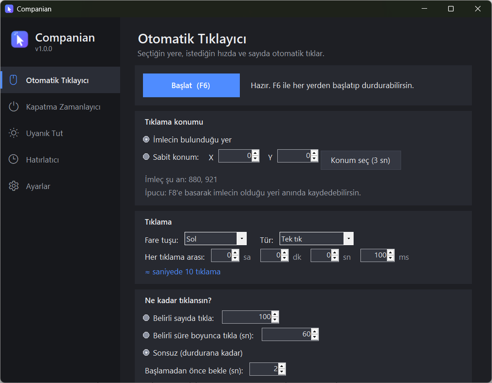
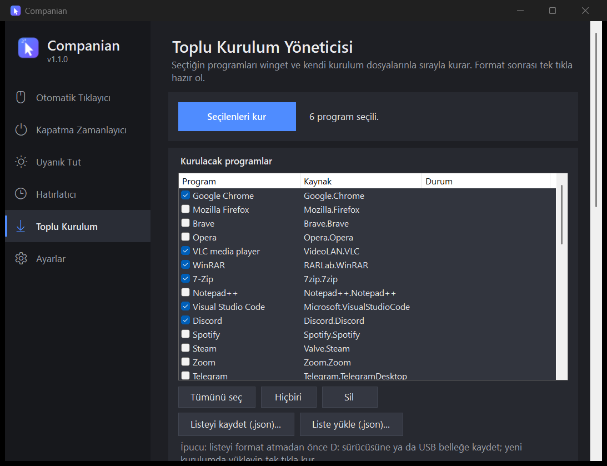
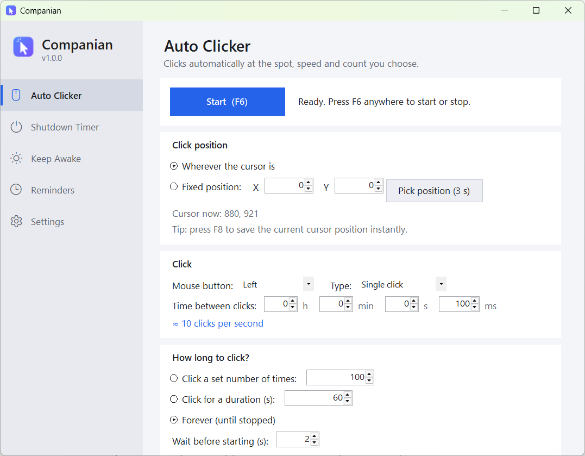

<p align="center">
  
</p>

<h1 align="center">Companian</h1>

<p align="center">
  Windows için küçük, hızlı ve taşınabilir bir yardımcı: <b>otomatik tıklayıcı</b>, <b>toplu kurulum yöneticisi</b>, <b>kapatma zamanlayıcısı</b>, <b>uyanık tutma</b> ve <b>hatırlatıcılar</b>.<br>
  A small, fast, portable Windows companion: <b>auto clicker</b>, <b>bulk install manager</b>, <b>shutdown timer</b>, <b>keep awake</b> and <b>reminders</b>.
</p>

<p align="center">
  <a href="https://github.com/nedimdmir/Companian/actions/workflows/build.yml"></a>
  <a href="https://github.com/nedimdmir/Companian/releases/latest"></a>
  
  
  <a href="LICENSE"></a>
</p>

<p align="center">
  
  
</p>

**[Türkçe](#türkçe)** · **[English](#english)**

---

## Türkçe

### Özellikler

| | |
|---|---|
| 🖱️ **Otomatik tıklayıcı** | İmlecin olduğu yere ya da seçtiğin sabit bir konuma tıklar. Sol / sağ / orta tuş, tek veya çift tık. Tıklama aralığını saat-dakika-saniye-milisaniye olarak ayarla (saniyede kaç tık olacağı anında gösterilir). **Belirli sayıda**, **belirli süre boyunca** veya **sonsuz** tıklama. Başlamadan önce bekleme süresi. **Konum listesi:** birden fazla konumu sıraya ekle, her biri için ayrı bekleme (ms) belirle, listeyi `.json` dosyası olarak kaydet ve tekrar yükle. |
| ⌨️ **Genel kısayollar** | **F6** her uygulamadayken tıklayıcıyı başlatır/durdurur. **F8** imleç konumunu kaydeder. Bu tuşlardan biri doluysa **Ctrl+Alt** ile otomatik yedek kısayol denenir. |
| 📦 **Toplu kurulum yöneticisi** | Format sonrası programlarını (Chrome, VLC, WinRAR, 7-Zip, VS Code... 40 hazır program) tek tek kurmak yerine işaretle, **winget** ile sırayla kurulsun. winget'te arama yapıp istediğin paketi ekleyebilir, kendi **.exe / .msi / .msix / .appx** kurulum dosyalarını da listeye koyabilirsin. Bilinen MSI, Inno Setup ve NSIS kurulumları tanınır; diğer EXE'ler kurulum penceresini açar ve gerekirse parametrelerini girebilirsin. **"Yalnızca benim için kur"** açıkken yönetici isteyenler atlanır; kapalıyken MSI için Windows yönetici onayı isteyebilir. MSIX/APPX Windows tarafından geçerli kullanıcıya kurulur. Her programın durumu ve kayıt (log) görünür. Listeyi `.json` olarak kaydet ve tekrar kullan. |
| ⏻ **Kapatma zamanlayıcısı** | Geri sayım ("1 saat sonra") ya da belirli bir saat ("23:30'da") sonunda **kapat, yeniden başlat, uyku, hazırda beklet, ekranı kilitle veya oturumu kapat**. Hızlı seçim düğmeleri (15 dk, 30 dk, 1 sa, 2 sa), son 1 dakikada iptal penceresi, isteğe bağlı zorla kapatma. |
| ☀️ **Uyanık tut** | Bilgisayarın uykuya geçmesini ve ekranın kapanmasını engeller; süresiz ya da belirli dakika boyunca. İsteğe bağlı olarak fareyi dakikada bir 1 piksel oynatır. |
| 🔔 **Hatırlatıcılar** | "30 dakika sonra mola ver" gibi tek seferlik veya tekrarlayan bildirimler. |
| 🛡️ **İsteğe bağlı yönetici kısayolu** | Ayarlar'dan bir kez yönetici onayı vererek Görev Zamanlayıcı'ya en yüksek ayrıcalıklı bir görev ekle ve masaüstü kısayoluyla uygulamayı sonraki açılışlarda UAC penceresi olmadan yönetici olarak başlat. |
| 🌍 **4 dil** | Türkçe, English, Deutsch, Español. Program anında dil değiştirir, ilk açılışta Windows dilini kullanır. |
| 🎨 **Koyu / açık tema** | Marka renklerine uygun lacivert-mor palet, okunaklı metinler ve Windows 11 koyu başlık çubuğu. |
| 📥 **Sistem tepsisi** | Kapatınca tepside çalışmaya devam eder; istersen Windows ile birlikte başlar. |

### Normal kullanım ve isteğe bağlı yönetici kısayolu

Companian normal kullanımda yönetici (UAC) izni istemez:

- Uygulama bildirimi (manifest) `asInvoker` olarak ayarlı; program her zaman senin normal kullanıcı haklarınla çalışır.
- **Taşınabilir kullanım:** `Companian.exe` dosyasını indirip doğrudan çalıştırman yeterli. Kurulum gerekmez.
- **Kullanıcıya özel kurulum:** *Ayarlar → Bu kullanıcı için kur* düğmesi programı `%LOCALAPPDATA%\Programs\Companian` klasörüne kopyalar, Başlat menüsüne (istersen masaüstüne) kısayol ekler ve *Yüklü uygulamalar* listesine kaydeder. Her şey senin profilinde ve `HKEY_CURRENT_USER` altında olduğu için Windows izin sormaz. Kaldırmak için *Ayarlar → Kaldır* ya da *Windows Ayarları → Uygulamalar*.
- **Yönetici olarak kullanmak istersen:** *Ayarlar → UAC Sormadan Çalıştırma Kısayolu Oluştur (Tek Seferlik Kurulum)* düğmesine bas. Bir kez UAC onayı verdikten sonra Companian, `OtomasyonAraci` adlı Görev Zamanlayıcı görevi ve masaüstü kısayolu oluşturur. Sonraki açılışlarda masaüstündeki bu kısayol uygulamayı yönetici olarak başlatır. Uygulamayı taşırsan kurulumu yeniden yap.

> **Not:** Exe dijital olarak imzalı olmadığı için Windows SmartScreen ilk açılışta "Windows bilgisayarınızı korudu" diyebilir. Bu bir yönetici izni değildir: **Ek bilgi → Yine de çalıştır** ile açabilirsin.

### İndir

En son sürüm: **[Releases](https://github.com/nedimdmir/Companian/releases/latest)** sayfasından `Companian.exe`.
Gereksinim: Windows 10 veya 11 (gerekli .NET Framework 4.8 zaten Windows'ta yüklü gelir).

### Kullanım ipuçları

1. **Otomatik Tıklayıcı** sekmesinde konumu seç: *İmlecin bulunduğu yer* ya da *Sabit konum*. Sabit konum için **F8**'e bas veya *Konum seç (3 sn)* düğmesine tıklayıp 3 saniye içinde imleci hedefe götür.
2. Tıklama aralığını ve ne kadar tıklanacağını (sayı / süre / sonsuz) ayarla.
3. **F6** ile başlat, yine **F6** ile durdur.

Tıklayıcı, yanlışlıkla kendi Başlat/Durdur düğmesine basmasın diye Companian penceresinin üzerindeyken tıklamaz.
Windows güvenlik kuralı gereği, normal haklarla çalışan bir program **yönetici olarak çalışan** pencerelere tıklama gönderemez.

**Konum listesi:** *Konum listesi (sırayla tıkla)* seçeneğini işaretle, imleci her hedefe götürüp **F8**'e bas. Her adımın tuşu, tek/çift tık ve tıklamadan sonraki bekleme süresi (ms) ayrı ayarlanır. Listeyi *Kaydet (.json)* ile sakla, *Yükle (.json)* ile geri aç.

#### Toplu kurulum

1. **Toplu Kurulum** sekmesinde kurmak istediğin programları işaretle. Listede yoksa *winget'te ara* kutusuyla bul ve ekle ya da *Kurulum dosyası ekle* ile kendi `.exe` / `.msi` / `.msix` dosyalarını seç.
2. **Yalnızca benim için kur** açık kalsın: programlar `--scope user` ile kullanıcı kapsamına kurulur ve hiçbir kurulum UAC penceresi açamaz. Yalnızca yönetici izniyle kurulabilen bir program varsa atlanır ve *"Yönetici izni gerekiyor"* olarak gösterilir.
3. **Seçilenleri kur**'a bas. Programlar arka planda sırayla kurulur; her birinin durumu listede, ayrıntılar *Kayıt* alanında görünür.
4. Format atmadan önce *Listeyi kaydet (.json)* ile listeyi başka bir sürücüye ya da USB belleğe kaydet; yeni Windows'ta Companian'ı açıp *Liste yükle* ve tek tıkla kur.

winget, Windows 10 (1809+) ve 11'de *Uygulama Yükleyicisi* ile birlikte gelir. Bulunamazsa Companian Microsoft Store sayfasını açmayı önerir.

### Kaynaktan derleme

Visual Studio veya .NET SDK gerekmez; Windows ile gelen C# derleyicisi kullanılır:

```powershell
powershell -ExecutionPolicy Bypass -File .\build.ps1
```

Çıktı: `dist\Companian.exe`. Simgeyi yeniden üretmek için `-RegenerateIcon` ekle.

---

## English

### Features

| | |
|---|---|
| 🖱️ **Auto clicker** | Clicks wherever the cursor is, or at a fixed position you pick. Left / right / middle button, single or double click. Set the interval in hours, minutes, seconds and milliseconds (clicks per second are shown live). Click **a set number of times**, **for a duration**, or **forever**. Optional start delay. **Position list:** queue several positions, give each its own wait (ms), and save or load the list as a `.json` file. |
| ⌨️ **Global hotkeys** | **F6** starts/stops the clicker from any app. **F8** saves the cursor position. If either key is busy, **Ctrl+Alt** fallbacks are tried automatically. |
| 📦 **Bulk install manager** | After a fresh Windows install, tick your programs (Chrome, VLC, WinRAR, 7-Zip, VS Code... 40 ready-made entries) and let **winget** install them one after another. Search winget to add a package, or add **.exe / .msi / .msix / .appx** installer files. Known MSI, Inno Setup and NSIS installers are detected; other EXE files open their own setup window and can take custom arguments. With **"Install for me only"** enabled, packages needing admin rights are skipped; with it disabled, MSI files can request Windows approval. Windows installs MSIX/APPX packages for the current user. Each program's status and log are shown in the app. Save the list as `.json` and reuse it. |
| ⏻ **Shutdown timer** | After a countdown ("in 1 hour") or at a set time ("at 23:30"): **shut down, restart, sleep, hibernate, lock or sign out**. Quick picks (15 min, 30 min, 1 h, 2 h), a cancel window in the last minute, optional force-close. |
| ☀️ **Keep awake** | Stops the PC from sleeping and the screen from turning off, indefinitely or for a number of minutes. Can nudge the mouse by 1 px every minute. |
| 🔔 **Reminders** | One-off or repeating on-screen notifications, e.g. "take a break in 30 minutes". |
| 🌍 **4 languages** | Türkçe, English, Deutsch, Español. Switches instantly; follows the Windows language on first run. |
| 🎨 **Dark / light theme** | Brand-matched navy and violet colors, readable contrast and the Windows 11 dark title bar. |
| 📥 **System tray** | Keeps running in the tray when closed and can start with Windows. |

### Normal use and optional administrator shortcut

Companian does not ask for administrator (UAC) rights during normal use:

- Its manifest uses `asInvoker`, so it always runs with your normal user rights.
- **Portable:** download `Companian.exe` and run it. No installation needed.
- **Per-user install:** *Settings → Install for this user* copies the app to `%LOCALAPPDATA%\Programs\Companian`, adds a Start menu (and optional desktop) shortcut and registers it under *Installed apps*. Everything lives in your profile and `HKEY_CURRENT_USER`, so Windows has nothing to ask permission for. Uninstall from *Settings → Uninstall* or *Windows Settings → Apps*.
- **If you want to run as administrator:** choose *Settings → Create Shortcut to Run Without UAC Prompt (One-Time Setup)*. After one UAC approval, Companian creates a highest-privilege Task Scheduler task named `OtomasyonAraci` and a desktop shortcut. Use that shortcut for later launches. Repeat setup if you move the app.

> **Note:** the exe is not code-signed, so Windows SmartScreen may show "Windows protected your PC" the first time. That is not an admin prompt: choose **More info → Run anyway**.

### Download

Get `Companian.exe` from the **[latest release](https://github.com/nedimdmir/Companian/releases/latest)**.
Requirements: Windows 10 or 11 (the .NET Framework 4.8 it needs ships with Windows).

<p align="center">
  
  
</p>

### Tips

1. On the **Auto Clicker** page choose *Wherever the cursor is* or *Fixed position*. For a fixed position press **F8**, or click *Pick position (3 s)* and move the cursor to the target within 3 seconds.
2. Set the interval and how long to click (count / duration / forever).
3. Press **F6** to start and **F6** again to stop.

The clicker skips clicks that would land on the Companian window, so it can never press its own Start/Stop button.
Windows does not let a normal-rights program send clicks to windows that run **as administrator** (UIPI).

**Position list:** choose *A list of positions (click in order)*, point at each target and press **F8**. Each step has its own button, single/double click and wait after the click (ms). Keep the list with *Save (.json)* and bring it back with *Load (.json)*.

#### Bulk install

1. On the **Bulk Install** page tick the programs you want. If one is missing, find it with *Search winget*, or pick your own `.exe` / `.msi` / `.msix` files with *Add setup files*.
2. Leave **Install for me only** on: packages install with `--scope user` and no installer can open a UAC prompt. Programs that can only be installed as administrator are skipped and shown as *"Needs admin rights"*.
3. Press **Install selected**. Programs install one after another in the background; each one's status is in the list and the details are in the *Log*.
4. Before reinstalling Windows, *Save list (.json)* to another drive or a USB stick; on the new system open Companian, *Load list* and install everything in one click.

winget ships with *App Installer* on Windows 10 (1809+) and 11. If it is missing, Companian offers to open its Microsoft Store page.

### Building from source

No Visual Studio or .NET SDK needed; it uses the C# compiler that ships with Windows:

```powershell
powershell -ExecutionPolicy Bypass -File .\build.ps1
```

Output: `dist\Companian.exe`. Add `-RegenerateIcon` to redraw the icon.

### Project layout

```
src/
  Program.cs     entry point, single instance, --tray / --uninstall switches
  MainForm.cs    the window and all pages
  Clicker.cs     background click engine (SendInput, ms timing)
  Sequence.cs    click-position lists, .json save / load
  Setup.cs       bulk install: winget + setup files, program catalog, .json lists
  Power.cs       shutdown / restart / sleep / lock, keep-awake
  Installer.cs   per-user install, shortcuts, autostart (HKCU only)
  Lang.cs        translations (tr, en, de, es)
  Ui.cs          theme, sidebar items, warning & reminder pop-ups
  Settings.cs    %APPDATA%\Companian\settings.ini
  Native.cs      Win32 API declarations
  app.manifest   asInvoker, DPI awareness
tools/IconGen.cs draws assets/companian.ico
build.ps1        build script
```

### Adding a language

Add a column to every `A(...)` line in [`src/Lang.cs`](src/Lang.cs) and add the code/name to `Codes` and `Names`.

## License

[MIT](LICENSE) © 2026 nedimdmir
