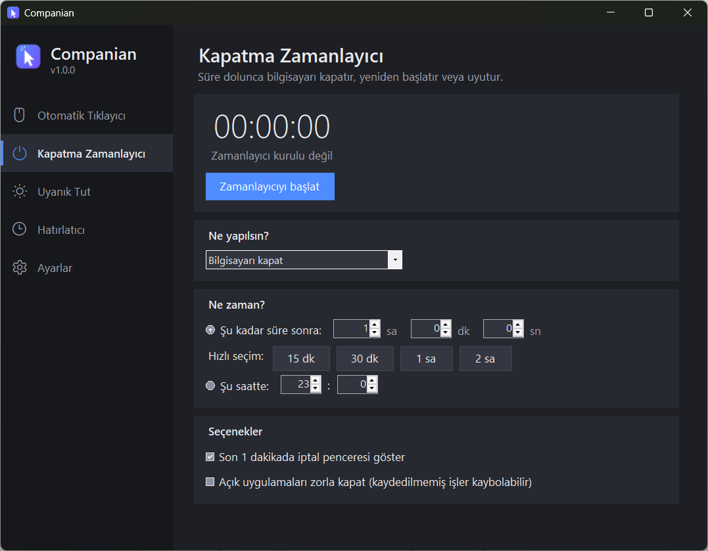
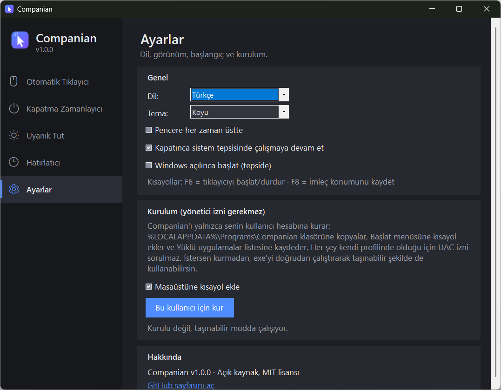

<p align="center">
  
</p>

<h1 align="center">Companian</h1>

<p align="center">
  Windows için küçük, hızlı ve taşınabilir bir yardımcı: <b>otomatik tıklayıcı</b>, <b>kapatma zamanlayıcısı</b>, <b>uyanık tutma</b> ve <b>hatırlatıcılar</b>.<br>
  A small, fast, portable Windows companion: <b>auto clicker</b>, <b>shutdown timer</b>, <b>keep awake</b> and <b>reminders</b>.
</p>

<p align="center">
  <a href="https://github.com/nedimdmir/Companian/actions/workflows/build.yml"></a>
  <a href="https://github.com/nedimdmir/Companian/releases/latest"></a>
  
  
  <a href="LICENSE"></a>
</p>

<p align="center">
  
  
</p>

**[Türkçe](#türkçe)** · **[English](#english)**

---

## Türkçe

### Özellikler

| | |
|---|---|
| 🖱️ **Otomatik tıklayıcı** | İmlecin olduğu yere ya da seçtiğin sabit bir konuma tıklar. Sol / sağ / orta tuş, tek veya çift tık. Tıklama aralığını saat-dakika-saniye-milisaniye olarak ayarla (saniyede kaç tık olacağı anında gösterilir). **Belirli sayıda**, **belirli süre boyunca** veya **sonsuz** tıklama. Başlamadan önce bekleme süresi. |
| ⌨️ **Genel kısayollar** | **F6** her uygulamadayken tıklayıcıyı başlatır/durdurur. **F8** imlecin o anki konumunu kaydeder. |
| ⏻ **Kapatma zamanlayıcısı** | Geri sayım ("1 saat sonra") ya da belirli bir saat ("23:30'da") sonunda **kapat, yeniden başlat, uyku, hazırda beklet, ekranı kilitle veya oturumu kapat**. Hızlı seçim düğmeleri (15 dk, 30 dk, 1 sa, 2 sa), son 1 dakikada iptal penceresi, isteğe bağlı zorla kapatma. |
| ☀️ **Uyanık tut** | Bilgisayarın uykuya geçmesini ve ekranın kapanmasını engeller; süresiz ya da belirli dakika boyunca. İsteğe bağlı olarak fareyi dakikada bir 1 piksel oynatır. |
| 🔔 **Hatırlatıcılar** | "30 dakika sonra mola ver" gibi tek seferlik veya tekrarlayan bildirimler. |
| 🌍 **4 dil** | Türkçe, English, Deutsch, Español. Program anında dil değiştirir, ilk açılışta Windows dilini kullanır. |
| 🎨 **Koyu / açık tema** | Windows 11 koyu başlık çubuğu desteğiyle. |
| 📥 **Sistem tepsisi** | Kapatınca tepside çalışmaya devam eder; istersen Windows ile birlikte başlar. |

### Yönetici izni olmadan kurulum

Companian **hiçbir zaman yönetici (UAC) izni istemez**:

- Uygulama bildirimi (manifest) `asInvoker` olarak ayarlı; program her zaman senin normal kullanıcı haklarınla çalışır.
- **Taşınabilir kullanım:** `Companian.exe` dosyasını indirip doğrudan çalıştırman yeterli. Kurulum gerekmez.
- **Kullanıcıya özel kurulum:** *Ayarlar → Bu kullanıcı için kur* düğmesi programı `%LOCALAPPDATA%\Programs\Companian` klasörüne kopyalar, Başlat menüsüne (istersen masaüstüne) kısayol ekler ve *Yüklü uygulamalar* listesine kaydeder. Her şey senin profilinde ve `HKEY_CURRENT_USER` altında olduğu için Windows izin sormaz. Kaldırmak için *Ayarlar → Kaldır* ya da *Windows Ayarları → Uygulamalar*.

> **Not:** Exe dijital olarak imzalı olmadığı için Windows SmartScreen ilk açılışta "Windows bilgisayarınızı korudu" diyebilir. Bu bir yönetici izni değildir: **Ek bilgi → Yine de çalıştır** ile açabilirsin.

### İndir

En son sürüm: **[Releases](https://github.com/nedimdmir/Companian/releases/latest)** sayfasından `Companian.exe`.
Gereksinim: Windows 10 veya 11 (gerekli .NET Framework 4.8 zaten Windows'ta yüklü gelir).

### Kullanım ipuçları

1. **Otomatik Tıklayıcı** sekmesinde konumu seç: *İmlecin bulunduğu yer* ya da *Sabit konum*. Sabit konum için **F8**'e bas veya *Konum seç (3 sn)* düğmesine tıklayıp 3 saniye içinde imleci hedefe götür.
2. Tıklama aralığını ve ne kadar tıklanacağını (sayı / süre / sonsuz) ayarla.
3. **F6** ile başlat, yine **F6** ile durdur.

Tıklayıcı, yanlışlıkla kendi Başlat/Durdur düğmesine basmasın diye Companian penceresinin üzerindeyken tıklamaz.
Windows güvenlik kuralı gereği, normal haklarla çalışan bir program **yönetici olarak çalışan** pencerelere tıklama gönderemez.

### Kaynaktan derleme

Visual Studio veya .NET SDK gerekmez; Windows ile gelen C# derleyicisi kullanılır:

```powershell
powershell -ExecutionPolicy Bypass -File .\build.ps1
```

Çıktı: `dist\Companian.exe`. Simgeyi yeniden üretmek için `-RegenerateIcon` ekle.

---

## English

### Features

| | |
|---|---|
| 🖱️ **Auto clicker** | Clicks wherever the cursor is, or at a fixed position you pick. Left / right / middle button, single or double click. Set the interval in hours, minutes, seconds and milliseconds (clicks per second are shown live). Click **a set number of times**, **for a duration**, or **forever**. Optional start delay. |
| ⌨️ **Global hotkeys** | **F6** starts/stops the clicker from any app. **F8** saves the current cursor position. |
| ⏻ **Shutdown timer** | After a countdown ("in 1 hour") or at a set time ("at 23:30"): **shut down, restart, sleep, hibernate, lock or sign out**. Quick picks (15 min, 30 min, 1 h, 2 h), a cancel window in the last minute, optional force-close. |
| ☀️ **Keep awake** | Stops the PC from sleeping and the screen from turning off, indefinitely or for a number of minutes. Can nudge the mouse by 1 px every minute. |
| 🔔 **Reminders** | One-off or repeating on-screen notifications, e.g. "take a break in 30 minutes". |
| 🌍 **4 languages** | Türkçe, English, Deutsch, Español. Switches instantly; follows the Windows language on first run. |
| 🎨 **Dark / light theme** | Including the Windows 11 dark title bar. |
| 📥 **System tray** | Keeps running in the tray when closed and can start with Windows. |

### Installing without admin rights

Companian **never asks for administrator (UAC) rights**:

- Its manifest uses `asInvoker`, so it always runs with your normal user rights.
- **Portable:** download `Companian.exe` and run it. No installation needed.
- **Per-user install:** *Settings → Install for this user* copies the app to `%LOCALAPPDATA%\Programs\Companian`, adds a Start menu (and optional desktop) shortcut and registers it under *Installed apps*. Everything lives in your profile and `HKEY_CURRENT_USER`, so Windows has nothing to ask permission for. Uninstall from *Settings → Uninstall* or *Windows Settings → Apps*.

> **Note:** the exe is not code-signed, so Windows SmartScreen may show "Windows protected your PC" the first time. That is not an admin prompt: choose **More info → Run anyway**.

### Download

Get `Companian.exe` from the **[latest release](https://github.com/nedimdmir/Companian/releases/latest)**.
Requirements: Windows 10 or 11 (the .NET Framework 4.8 it needs ships with Windows).

<p align="center">
  
  
</p>

### Tips

1. On the **Auto Clicker** page choose *Wherever the cursor is* or *Fixed position*. For a fixed position press **F8**, or click *Pick position (3 s)* and move the cursor to the target within 3 seconds.
2. Set the interval and how long to click (count / duration / forever).
3. Press **F6** to start and **F6** again to stop.

The clicker skips clicks that would land on the Companian window, so it can never press its own Start/Stop button.
Windows does not let a normal-rights program send clicks to windows that run **as administrator** (UIPI).

### Building from source

No Visual Studio or .NET SDK needed; it uses the C# compiler that ships with Windows:

```powershell
powershell -ExecutionPolicy Bypass -File .\build.ps1
```

Output: `dist\Companian.exe`. Add `-RegenerateIcon` to redraw the icon.

### Project layout

```
src/
  Program.cs     entry point, single instance, --tray / --uninstall switches
  MainForm.cs    the window and all pages
  Clicker.cs     background click engine (SendInput, ms timing)
  Power.cs       shutdown / restart / sleep / lock, keep-awake
  Installer.cs   per-user install, shortcuts, autostart (HKCU only)
  Lang.cs        translations (tr, en, de, es)
  Ui.cs          theme, sidebar items, warning & reminder pop-ups
  Settings.cs    %APPDATA%\Companian\settings.ini
  Native.cs      Win32 API declarations
  app.manifest   asInvoker, DPI awareness
tools/IconGen.cs draws assets/companian.ico
build.ps1        build script
```

### Adding a language

Add a column to every `A(...)` line in [`src/Lang.cs`](src/Lang.cs) and add the code/name to `Codes` and `Names`.

## License

[MIT](LICENSE) © 2026 nedimdmir
